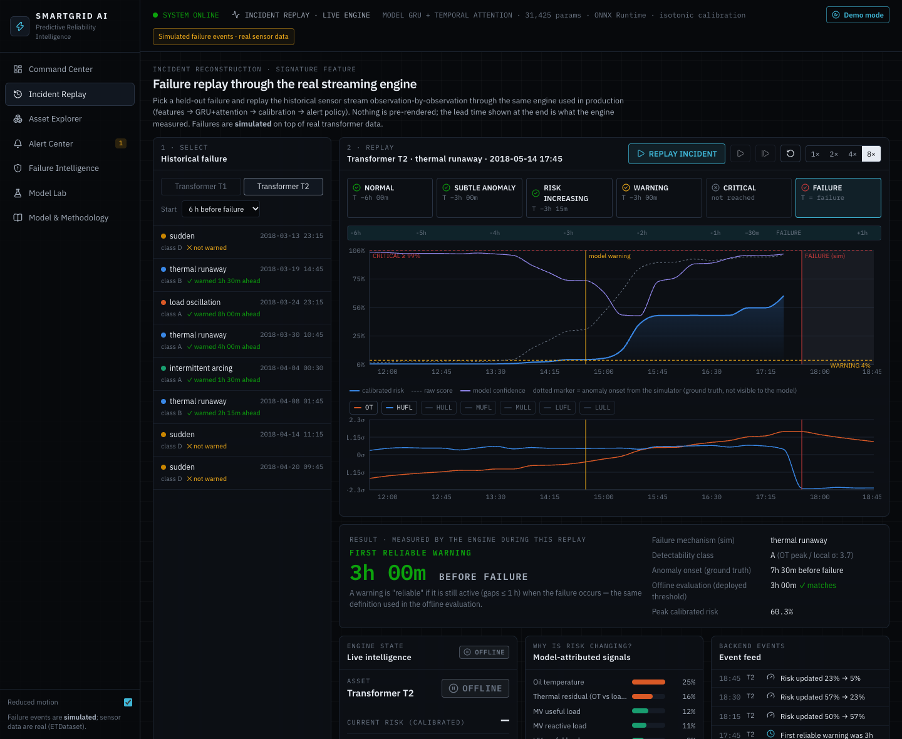
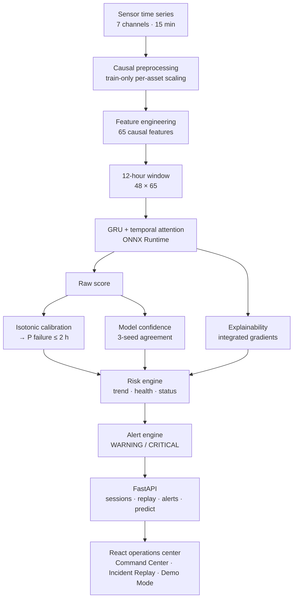
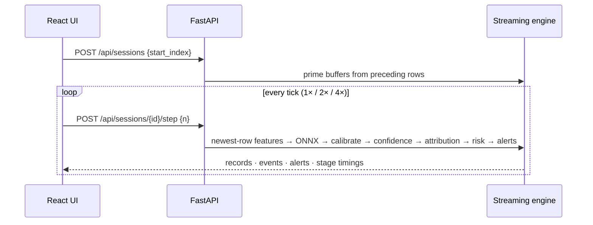
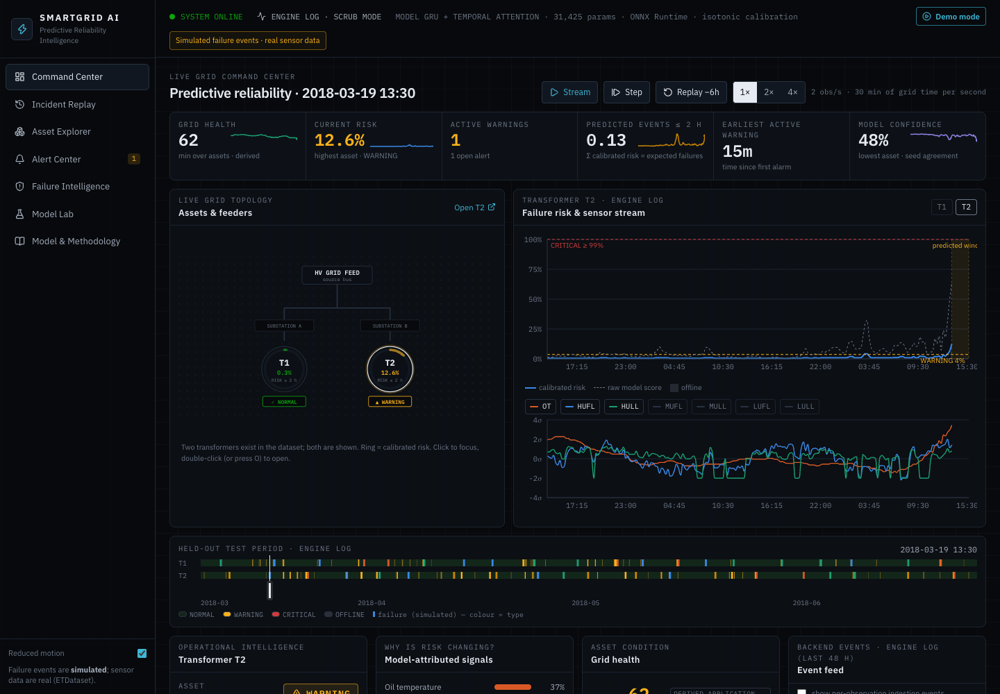
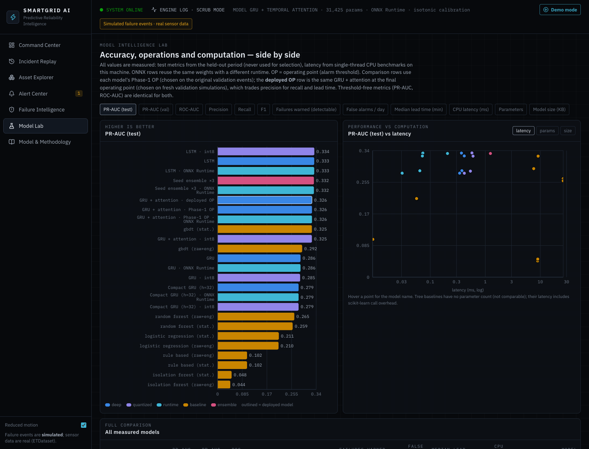
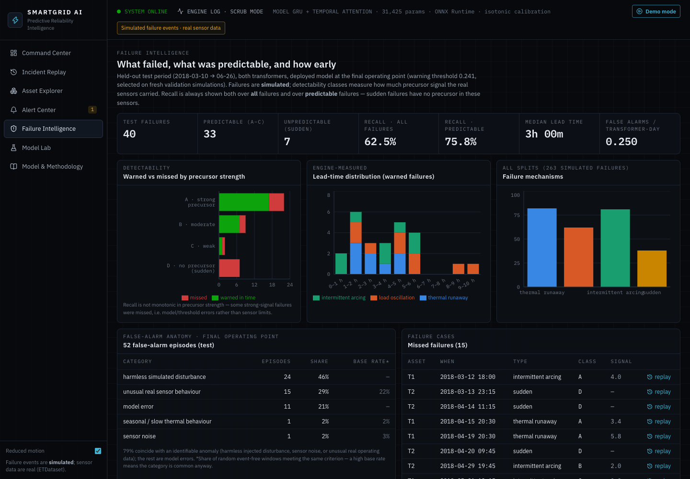

# SmartGrid AI

**Real-time predictive-maintenance and early-warning platform for power-transformer sensor streams.**

A GRU + temporal-attention model reads a 12-hour window of causal features and estimates the risk of a failure
within the next 2 hours. Its score is calibrated, given a model-confidence estimate, explained, and turned into
alerts by a streaming engine. The engine is served through FastAPI and a React/TypeScript operations center
with **Incident Replay** and a guided **Demo Mode** that run the real engine on held-out data.

**Live results site:** <https://predictive-maintenance-power-grid.vercel.app>. It is a static snapshot of the
results pages (Failure Intelligence, Model Lab, Methodology). The live engine views (Command Center, Incident
Replay, Demo Mode) need the Python engine and the ETDataset sensor rows, so they [run locally](#quick-start).

> [!IMPORTANT]
> **Sensor data are real; failure events are simulated.** The sensor data come from ETDataset (two real
> transformers, 15-minute readings). ETDataset has no failure labels, so failure precursors are injected by a
> seeded, documented simulator. Every result measures detection of these *simulated* signatures inside real
> operating data. This is a decision-support research prototype. It is **not** deployed on a real grid, it
> does not predict real physical failures, and it does not claim to prevent outages. Attributions are
> associational, not causal.

<p align="center"></p>

| Model | Held-out test PR-AUC | Predictable failures warned | Median lead time | Engine step latency |
|:---:|:---:|:---:|:---:|:---:|
| GRU + temporal attention<br>31,425 parameters | **0.326**<br>ROC-AUC 0.845 | **75.8 %**<br>(62.5 % of all failures) | **3 h** | **5.5 ms p50**<br>ONNX inference 0.07 ms |

---

## Contents
[Capabilities](#key-capabilities) · [Architecture](#architecture) · [Model & evaluation](#final-model-and-evaluation-protocol) ·
[Results](#results) · [Incident Replay & Demo Mode](#incident-replay) · [Quick start](#quick-start) ·
[API](#api) · [Testing](#testing) · [Dataset & license](#dataset-and-license) · [Limitations](#known-limitations)

## Key capabilities
- **Leakage-safe temporal ML.** Chronological splits with an embargo, causal features, training-only fitting,
  and 16 automated temporal-integrity tests. Model selection never touches test data, and a test proves it.
- **Calibrated, explainable risk.** Isotonic calibration, a 3-seed model-confidence score, and
  integrated-gradients attributions labelled as *what the model relied on*.
- **Streaming inference engine.** Each new reading flows through newest-row NumPy features, an ONNX Runtime
  GRU, calibration, confidence, attribution, a risk engine and an alert engine, in 5.5 ms p50.
- **Operations UI.** Command Center, Incident Replay, Asset Explorer, Alert Center, Failure Intelligence,
  Model Lab and Methodology views, all driven by the backend. Nothing is mocked.
- **Honest evaluation.** Recall is reported over all and over predictable failures. The report also covers
  false-alarm anatomy with base rates, stress-test robustness, cross-asset transfer, and negative results.
- **Engineering hygiene.** Pydantic validation, structured JSON logs, request IDs, readiness and metrics
  endpoints, a path-traversal fix, pinned dependencies and a reproducible setup.

## Architecture



**Streaming.** The UI opens a session at any point in the held-out period. The backend primes the buffers from
the preceding rows in one vectorised pass, which is tested to equal step-by-step warm-up. Every tick is a
`POST /api/sessions/{id}/step`, and the engine returns records, events, alerts and measured per-stage timings.



**Tech stack.**
- **ML:** Python 3.11, PyTorch, ONNX Runtime, scikit-learn, NumPy/pandas.
- **Backend:** FastAPI, Pydantic, Uvicorn.
- **Frontend:** React 19, TypeScript, Vite, Tailwind, Recharts, Framer Motion, Zustand.
- **Quality:** pytest, Vitest, ruff, oxlint, pip-audit, npm audit.

## Final model and evaluation protocol
- **Model:** a GRU (64 units) plus additive temporal attention over 48 × 15-minute steps of 65 causal features,
  predicting failure within 2 hours. It has 31,425 parameters (127 KB).
- **Selection:** 3 training seeds × 5 freshly re-simulated validation periods. A challenger must beat the
  incumbent's mean PR-AUC by more than max(0.01, 1 SE). The test period is never used for any decision.

| Candidate | Fresh-validation PR-AUC, mean ± std [min, max] | Params |
|---|---|---|
| **GRU + attention (kept)** | **0.360 ± 0.056** [0.26, 0.47] | 31,425 |
| GRU | 0.347 ± 0.044 [0.27, 0.43] | 27,265 |
| Compact GRU (h = 32) | 0.342 ± 0.038 [0.28, 0.41] | 9,537 |
| TCN | 0.327 ± 0.060 [0.24, 0.44] | 33,697 |
| LSTM + attention | 0.310 ± 0.059 [0.20, 0.41] | 39,809 |
| Lightweight transformer | 0.283 ± 0.048 [0.19, 0.36] | 23,489 |

None of the challengers clears the margin; plain GRU is within one standard error. The single-realisation
validation used in Phase 1 had over-stated PR-AUC (0.553 vs 0.36 on fresh events), which is why this protocol
exists ([reports/model_selection_protocol.md](reports/model_selection_protocol.md)).

**Operating point.** WARNING is set by maximising F1 subject to recall ≥ 0.70 on pooled fresh validation. This
gives a raw threshold of **0.241**, which corresponds to a calibrated risk of about 4 %. CRITICAL is the
lowest threshold with ≥ 90 % validation precision. An alarm needs 2 consecutive steps over the threshold. The
historical Phase-1 threshold was 0.659 (see [Threshold history](#threshold-history)).

## Results
All numbers below are from the held-out test period (2018-03-10 → 2018-06-26), both transformers, the deployed
model at the final operating point. Source: [`reports/final/final_metrics.json`](reports/final/final_metrics.json).

| Metric | Value |
|---|---|
| PR-AUC / ROC-AUC (prevalence ≈ 1.6 %) | **0.326** / 0.845 |
| Precision / recall / F1 (per 15-min step, 2 h horizon) | 0.171 / 0.575 / 0.264 |
| Failures warned in time: all / **predictable** (classes A–C) | 62.5 % (25/40) / **75.8 %** (25/33) |
| Lead time of first reliable warning | median **3.0 h**, mean 3.5 h, range 0.25–11.5 h |
| False alarms | **0.25 per transformer-day** (52 episodes over 208 transformer-days) |

**Calibration** (isotonic, fitted on validation only). Brier score 0.0248 → **0.0125**; expected calibration
error 0.039 → **0.003**. Calibration is monotone, so alarms and PR-AUC are unchanged. The UI never displays a
calibrated risk above "≥ 99 %".

**Model confidence ≠ physical certainty.** Confidence is 1 − 2·σ of three independently seeded models. On test,
alarm precision was **63 %** for HIGH confidence (≥ 0.9), 13 % for MEDIUM and 9 % for LOW. HIGH vs not-HIGH
is a useful triage signal; MEDIUM and LOW are indistinguishable.

**Streaming latency.** Measured by `make benchmark` on an Apple M2 (1 thread), idle machine:

| Stage (one observation) | p50 ms | p95 ms | p99 ms |
|---|---|---|---|
| Features · NumPy newest row (deployed) | 0.511 | 0.541 | 0.562 |
| Features · pandas full recompute (before) | 7.185 | 7.357 | 7.690 |
| Model · ONNX Runtime (deployed) | 0.072 | 0.079 | 0.083 |
| Model · PyTorch eager | 0.391 | 0.424 | 0.485 |
| Confidence · 3 seed members | 1.176 | 1.216 | 1.259 |
| Attribution · integrated gradients | 3.445 | 3.519 | 3.606 |
| **Engine step · ingest → alert** | **5.490** | **5.678** | **6.073** |
| HTTP · `POST /step`, 1 observation × 2 transformers | 13.13 | 13.42 | 13.67 |

Full tables, including API, batch throughput and browser timings: [`reports/performance_benchmark.md`](reports/performance_benchmark.md).

**Robustness.** Signatures were made weaker, delayed, intermittent, irregular, asset-varied and overlapping.
Each level has 5 re-simulations × 3 seeds, and each seed uses its own protocol threshold:

| Stress level | PR-AUC | Predictable failures warned | Median lead | False alarms/day |
|---|---|---|---|---|
| NORMAL | 0.38 | 86 % | 197 min | 0.52 |
| MILD | 0.32 | 83 % | 161 min | 0.52 |
| MODERATE | 0.25 | 75 % | 130 min | 0.52 |
| SEVERE | 0.20 | 66 % | 117 min | 0.52 |

Training on MODERATE-profile signatures raised recall under stress but cost 0.09 PR-AUC in normal conditions,
with no mean gain under stress. It was **not adopted** (negative result).

**Cross-asset generalisation is weak.** Training on one transformer and testing on the other gives PR-AUC
0.133 (T1 → T2) and 0.242 (T2 → T1), against about 0.33 in-domain. A label-free domain-invariant feature subset
(27 features with PSI < 0.1) changed this by −0.005 on average, so it was **not adopted**.

**False alarms (52 test episodes).**

| Category | Episodes | Share | Base rate in quiet windows |
|---|---|---|---|
| Harmless simulated disturbance | 24 | 46 % | — |
| Unusual real sensor behaviour | 15 | 29 % | 22 % |
| Model error | 11 | 21 % | — |
| Sensor noise | 1 | 2 % | 3 % |
| Seasonal / slow thermal behaviour | 1 | 2 % | 2 % |

Every episode can be inspected in the UI (Failure Intelligence → false-alarm explorer).
See [`reports/final_false_alarm_analysis.md`](reports/final_false_alarm_analysis.md).

<a id="threshold-history"></a>
**Threshold history.** Phase 1 used a threshold of 0.659, chosen on one set of simulated validation events.
On the same test data it gave precision 0.318, recall 0.487, 0.115 false alarms/day and a median lead of 2 h.
Re-deriving the threshold on fresh validation simulations lowered it to 0.241. The current system therefore
warns more often and earlier, at the cost of lower precision. PR-AUC and ROC-AUC do not depend on the threshold.

## Incident Replay
Pick a transformer and a held-out failure, then press **REPLAY INCIDENT**. The historical sensor stream is
pushed through the real engine one observation at a time, starting 3, 6 or 12 h before the failure. Each stage
(Normal → Subtle anomaly → Risk increasing → Warning → Critical → Failure) is triggered by actual engine output.
The result card shows **FIRST RELIABLE WARNING · 3h 00m BEFORE FAILURE**, or **NO RELIABLE WARNING DETECTED**
with the reason. It also checks the result against the offline evaluation; a test asserts that the two agree
for all 40 test failures.

## Demo Mode
Click **Demo mode** in the header, or open `http://127.0.0.1:8000/?demo=1`, for an 8-step guided tour:
1. System status.
2. Example transformer.
3. Live simulation, starting 4 h before the first warning at 1×.
4. Rising risk.
5. Explanation.
6. Incident Replay.
7. Model performance.
8. Latency.

The example is chosen from real held-out data: the strong-signal warned failure whose engine lead time is
closest to the median. Every number shown comes from the backend.

## Screenshots
| Command Center | Model Lab |
|---|---|
|  |  |
| **Failure Intelligence** | **Incident Replay** |
|  |  |

## Quick start
Requires Python 3.11, Node 20+ and an internet connection (the dataset is downloaded at setup).

```bash
make setup     # venv + pinned Python deps + npm ci                      (~3 min)
make data      # download ETDataset, rebuild the simulation, train the deployed models, replay the test period (~30 min, first run)
make demo      # build the UI and serve everything on http://127.0.0.1:8000  → click "Demo mode"
```

Trained weights are **not** in the repository (see [DATASET.md](DATASET.md)). The first `make data` trains the
deployed GRU + attention model, its 3-seed ensemble and the preprocessing from the committed configuration
(`make models`, ~20–30 min on a laptop CPU, no hyper-parameter search) and exports ONNX. On the development
machine the retrained weights were bit-for-bit identical to the ones behind every reported result. On other
hardware, tiny floating-point differences are possible.

`make web` starts the hot-reloading frontend on :5173 against `make api`. The full research pipeline is
optional: `make train` (~2.5 h), then `make final`.

**Docker:** a `Dockerfile` and `docker-compose.yml` are provided (`docker compose up --build`; the build runs
`make data`, including model training). They **have never been built or run**, because Docker was unavailable
in the development environment. Treat them as an untested starting point.

**Static results site** (`make site`): a `VITE_STATIC=1` frontend build plus aggregate JSON exported from the real
API by [`backend/export_results.py`](backend/export_results.py), which refuses to write anything that looks like
sensor rows. Deploy with `cd site && vercel deploy --prod`. Live views show a notice and a real screenshot.

## API
FastAPI ([`backend/app.py`](backend/app.py)). The model, calibrator, ONNX session and seed ensemble are loaded
**once** at startup. Interactive docs are at `/docs`.

| Endpoint | Purpose |
|---|---|
| `GET /api/health` · `GET /api/ready` | Liveness; readiness (model, data, engine log), 503 if not ready |
| `GET /api/model` · `GET /api/metrics` | Model metadata (features, thresholds, calibration, weights hash); request and engine latency p50/p95/p99 |
| `POST /api/predict` | Score posted sensor history (finite values, strictly increasing timestamps, ≤ 5,000 rows) |
| `POST /api/sessions` · `POST /api/sessions/{id}/step` · `DELETE /api/sessions/{id}` | Live streaming through the engine |
| `GET /api/incidents` · `POST /api/incidents/{asset}/{id}/replay` | Incident Replay |
| `GET /api/alerts` · `POST`/`DELETE /api/alerts/{id}/ack` | Alert Center |
| `GET /api/timeline` · `/api/log` · `/api/snapshot` | Engine log for the time scrubber |
| `GET /api/system` · `/api/analytics/failures` · `/api/models` · `/api/patterns` · `/api/methodology` | Data for the UI |

## Testing
```bash
make test      # pytest (76 tests) + Vitest (10 tests)
make check     # + ruff, pip-audit, tsc, oxlint, production build, npm audit
```

- **Temporal integrity** ([`tests/test_temporal_integrity.py`](tests/test_temporal_integrity.py)):
  - features are invariant to perturbing the future, on real data
  - scalers and fits use training data only
  - no simulator or label leakage
  - sequences never cross splits
  - every model-selection decision is unchanged when every test column is scrambled
  - the deployed threshold and calibrator are re-derived exactly from validation data
- **API** (`tests/test_api_robustness.py`, `tests/test_backend.py`):
  - validation, graceful 503s, path traversal, the SPA cache header
  - replay lead time equals the offline evaluation
  - the API and CLI use the same thresholds
- **Streaming:** the fast newest-row features equal the full pandas recomputation.

## Reproducibility
Python and npm dependencies are pinned. The simulation is seeded and regenerates bit-for-bit (tested). `make data`
recreates every git-ignored artefact the app needs. Thresholds, calibrator and model choice live in **one**
place, [`models/phase2/deployment.json`](models/phase2/deployment.json), which the API, CLI tools and UI all
read; tests enforce this. To rerun the research pipeline: `make train`, `make final`, `make precompute`,
`make benchmark`.

## Dataset and license
- **Code:** MIT ([LICENSE](LICENSE)).
- **Data:** [ETDataset](https://github.com/zhouhaoyi/ETDataset) by Zhou et al. (Informer, AAAI 2021), licensed
  **CC BY-ND 4.0**. It is downloaded at setup and **not redistributed**. Files holding row-level sensor values
  (raw, or with simulated faults injected) are git-ignored and rebuilt locally.
- **Model weights:** **not published.** Whether weights trained on CC BY-ND data may be redistributed is
  unresolved, so they are git-ignored and retrained locally by `make data`
  (see [DATASET.md](DATASET.md)). Figures and screenshots showing sensor curves are kept with attribution;
  their status is discussed there too.

## Security notes
- Inputs are validated with Pydantic schemas and bounds.
- A global error handler means no stack traces reach clients; every response carries a request ID.
- CORS is limited to GET/POST/DELETE, with origins set by `SGPM_CORS_ORIGINS`.
- Static files are served only from inside `frontend/dist`. A path-traversal bug that exposed
  `configs/config.yaml` was found and fixed, with a regression test.
- No secrets are needed or stored.
- `pip-audit` and `npm audit` report 0 known vulnerabilities.
- Not implemented: authentication. This is a local demo, not a multi-user service.

## Known limitations
- Failure labels are simulated, at a much higher rate than reality; results describe the simulated signatures.
- There are only two transformers, and cross-asset transfer is weak.
- 40 test failures give wide uncertainty; seed variance alone spans fresh-validation PR-AUC 0.26–0.47.
- 7 test failures are sudden (no precursor) and are undetectable by construction.
- The operating point trades precision (0.17) for recall and lead time.
- No voltage, current, frequency, weather or maintenance data exist in the dataset, and none are fabricated.
- The health score is an application-defined composite. Attributions are associational, not causal.
- The Docker image has never been built or run.

## Repository structure
```
backend/            FastAPI app · streaming engine · sessions · schemas · observability
frontend/           React + TypeScript operations center (Vite)
src/data/           download · seeded failure simulation · model-ready pipeline
src/features/       causal feature engineering (+ NumPy newest-row path)
src/preprocessing/  splits with embargo · train-only scaling · leakage checks
src/models/         GRU/LSTM/attention · TCN · transformer · baselines
src/training/       trainer · experiment stages · Phase-1 selection
src/phase2/, src/final/   re-simulation · calibration · selection protocol · robustness · cross-asset · benchmark
configs/            config.yaml · failure_simulation.yaml
models/             deployment.json (single source of truth), calibrators, metadata; weights are trained locally
tests/              pytest suites (temporal integrity, API, streaming, simulation, metrics)
reports/            final metrics · audits · protocol · false alarms · performance · figures
docs/               interview guide · resume summary · research log · screenshots
dashboard/, app.py  legacy Streamlit research dashboard
```

## Future work
- Real trip and maintenance labels with rolling-origin evaluation.
- More assets and channels: DGA, winding temperature, voltage, current, ambient temperature.
- Per-asset fine-tuning or hierarchical models for cross-asset transfer.
- Thresholds chosen from a cost model agreed with operators.

**Further reading:**
[Final quality report](reports/final_project_quality_report.md) ·
[Resume readiness](reports/final_resume_readiness.md) ·
[Audit](reports/final_project_audit.md) ·
[Model-selection protocol](reports/model_selection_protocol.md) ·
[Interview guide](docs/interview_guide.md) ·
[Research log](docs/research_log.md)
