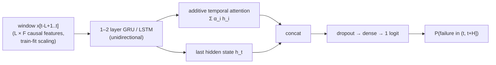
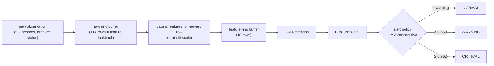

# Research log (Phase 1 & Phase 2 README, preserved verbatim)

> Superseded by the top-level README for the final results; kept for the full experimental history.

# Predictive Maintenance & Grid-Asset Failure Early Warning with Sequential Deep Learning

An end-to-end, leakage-audited pipeline that ingests multivariate 15-minute sensor streams from power
transformers, learns pre-failure signatures with causal recurrent networks (LSTM / GRU / attention),
and raises **NORMAL / WARNING / CRITICAL** early warnings in a streaming engine and a Streamlit dashboard.

> **Read this first: what is real and what is simulated.**
> All sensor measurements are **real** (ETDataset, two transformers, 2016-07 → 2018-06).
> No public dataset pairs these signals with real failure labels, so **failure events are simulated** by a
> documented, seeded fault-injection layer on top of the real signals (§3). Every injected perturbation is
> stored in separate `sim_*` columns, so the real measurement can always be recovered. The leakage checker
> guarantees these columns never reach the model. All numbers below come from runs in this repository; none
> are copied from elsewhere. They describe how well the model detects **these simulated fault signatures
> embedded in real operating data**. They are **not** claims about real-world transformer failure rates.

### Results at a glance (held-out test period, 2018-03-10 → 06-26, both transformers)

| Selected model | GRU + temporal attention · 1 layer · hidden 64 · 12 h window · 65 causal "stationary" features · **31,425 params · 127 KB** |
|---|---|
| Sample-level (H = 2 h) | PR-AUC **0.326** (prevalence 0.016) · ROC-AUC **0.845** · precision **0.318** · recall **0.488** · F1 **0.385** · FPR 1.7 % |
| Event-level | **24 / 40** failures warned in time. That is **24 / 33 (73 %) of failures that have a precursor**; the other 7 are sudden by design. |
| Lead time (detected) | median **2.0 h**, mean 2.4 h, min 0.25 h, max 9.0 h |
| False alarms | **0.12 per day** (0.81 per week), alarm active 2.1 % of the time |
| Inference | **0.42 ms** per step (PyTorch, 1 CPU thread) · **0.07 ms** (ONNX Runtime) · 8.4 ms end-to-end streaming incl. features |

Validation (used for every decision) was better: PR-AUC 0.553, 89 % of detectable failures warned, median lead 3.6 h, 0.08 false alarms/day.
The validation → test drop is analysed in §10. It comes mostly from undetectable sudden failures and a seasonal regime shift.


## Phase 2 — research iteration and operations platform

Phase 2 re-audited the system, verified the Phase-1 results, investigated *why* test looked worse than
validation, ran a 54-run three-seed experiment grid, added calibration and a confidence layer, and wrapped the real
streaming engine in a FastAPI backend with a React operations frontend. Full report:
[`reports/phase2_final_report.md`](reports/phase2_final_report.md). All Phase-1 artefacts are untouched.

**Key findings (all measured):**

| Question | Answer |
|---|---|
| Do the Phase-1 numbers reproduce? | Yes, exactly ([`reports/phase2/reproduction.md`](reports/phase2/reproduction.md)) |
| Why was test (0.33) worse than validation (0.55)? | Mostly **sampling luck + selection on the original validation events**. Re-simulating the events 8× on the same real data: val 0.450 vs test 0.444 (detectable PR-AUC); the model scores 0.360 ± 0.034 on *fresh* validation events ([`reports/phase2_distribution_shift.md`](reports/phase2_distribution_shift.md)) |
| Detectability | 7 of 40 test failures are sudden (no precursor). Recall: all failures 60.0%, detectable 72.7%; misses include strong-signal failures ([`reports/detectability_analysis.md`](reports/detectability_analysis.md)) |
| Better model? | **No.** GRU, compact GRU, LSTM+attention, TCN, lightweight transformer, 4 feature variants: none beat the incumbent on fresh-validation PR-AUC (3 seeds, pre-declared margin). Phase-1 GRU+attention kept |
| Multi-horizon (30 m/1 h/2 h/4 h) | One hazard model matches the 2 h model and beats the 4 h model, but its 30-min head misses the tolerance → **not adopted** |
| Cross-asset transfer | Weak both ways: T1→T2 PR-AUC 0.133 vs 0.327 in-domain; T2→T1 0.242 vs 0.336 |
| Calibration | Isotonic (fitted on validation only): test Brier 0.0248 → 0.0131, ECE 0.0390 → 0.0045 |
| Confidence (3-seed agreement) | High-confidence alarms were correct 49% of the time vs 14% for low-confidence ones (AUROC for flagging false alarms 0.73) |
| False alarms | Most coincide with a genuine anomaly (harmless injected disturbance or unusual real data) ([`reports/false_alarm_analysis.md`](reports/false_alarm_analysis.md)) |
| Robustness | Weaker / intermittent / delayed signatures: detection drops sharply when all are combined ([`reports/phase2/stress_test_summary.csv`](reports/phase2/stress_test_summary.csv)) |
| Engine latency | 14.3 ms per observation median (features 8.5 ms, ONNX inference 0.13 ms, attribution 4.0 ms) |

### Run the platform

```bash
# backend (FastAPI over the Python ML system) — http://127.0.0.1:8000
.venv/bin/uvicorn backend.app:app --host 127.0.0.1 --port 8000
# frontend dev server — http://localhost:5173 (proxies /api to the backend)
cd frontend && npm install && npm run dev
# or: production build served by the backend itself at http://127.0.0.1:8000
cd frontend && npm run build
```

Regenerate Phase-2 artefacts: `python -m src.phase2.reproduce`, `python -m src.phase2.analysis`,
`python -m src.phase2.calibration`, `python -m src.phase2.experiments` (≈ 2 h), `python -m src.phase2.report`,
`python -m backend.precompute` (engine log for the timeline scrubber).

```mermaid
flowchart LR
  D[(ETT sensor data + simulated events)] --> E[Intelligence engine<br/>features → GRU+attn (ONNX) → isotonic calibration<br/>3-seed confidence · integrated gradients · risk & alert engine]
  E --> L[(engine log<br/>held-out period)]
  E --> S[live / replay sessions]
  L --> A[FastAPI /api]
  S --> A
  A --> F[React operations center<br/>command center · incident replay · assets · alerts · failures · model lab · methodology]
```

Views: **Command Center** (topology, hero intelligence, synchronized risk/sensor charts, global time scrubber, live
Stream/Step/Replay at 1×/2×/4×, event feed, measured pipeline timings) · **Incident Replay** (signature feature:
replays a held-out failure through the real engine and reports the measured lead time) · **Asset Explorer** ·
**Alert Center** (Investigate / Replay / Acknowledge) · **Failure Intelligence** · **Model Lab** · **Model & Methodology**.

---

## 1. Problem & motivation

Transformers and other grid assets usually fail after an **incipient-fault stage**: cooling degradation,
growing load instability, or intermittent partial discharge / arcing. During that stage the multivariate sensor
stream drifts away from normal behaviour hours before a trip. Detecting that drift early gives operators time
to shed load, dispatch crews or reconfigure the network. The detector must be *operationally* useful:

* high recall on *failure events*, with alarms early enough to act on (lead time);
* few false alarms per day (alarm fatigue is the main reason such systems get switched off);
* cheap enough to run on every new observation of every asset.

Accuracy is meaningless at a ~1.6 % positive rate (predicting "never fails" scores 98.4 %), so it is reported
only for completeness.

## 2. Problem formulation

| Question | Decision |
|---|---|
| What is a **failure**? | A transformer trip at time `t_f` (simulated, §3). The asset is then offline for 2–8 h. |
| What is an **anomaly**? | The incipient-fault (precursor) stage `[t_f − D, t_f)`, `D ∈ [3 h, 18 h]`. *Benign* transients are also anomalies, but they do **not** lead to failure. |
| Target | `y_t = 1  ⇔  a failure occurs in (t, t + H]`, with `H = 8` steps = **2 h** (horizon compared in §8). |
| Inputs | Only observations at `t' ≤ t`: a window of the last `L` steps of causal features. |
| Formulation | **Binary classification on sliding windows (failure-within-horizon)**, evaluated *both* per sample and per **event** (lead time, false-alarm episodes). An unsupervised anomaly detector (Isolation Forest) and a rule-based detector serve as baselines. |
| Why not RUL / survival? | Failures are discrete trips preceded by a variable-length precursor, not gradual wear to end-of-life. A remaining-useful-life target would be undefined for most of the timeline. Failure-within-H plus event-level lead-time analysis answers the operational question directly. |
| Why not pure forecasting? | Forecasting the sensors and thresholding the residual is a weaker signal than learning failure signatures directly. The rule-based residual detector is included as that baseline. |

## 3. Dataset

| Property | Value |
|---|---|
| Name / source | **ETDataset (ETT-small, ETTm1 + ETTm2)**, Zhou et al., *Informer* (AAAI 2021) — <https://github.com/zhouhaoyi/ETDataset> (CC BY-ND 4.0). Downloaded automatically. |
| What it is | Real SCADA measurements from **two power transformers** at two Chinese substations |
| Samples | 69,680 rows per transformer (139,360 total) |
| Sampling | 15 min, perfectly regular: 0 missing values, 0 duplicate timestamps (verified in `reports/eda_summary.json`) |
| Time range | 2016-07-01 00:00 → 2018-06-26 19:45 |
| Features (7) | `HUFL, MUFL, LUFL` (high/mid/low-voltage *useful* load), `HULL, MULL, LULL` (*useless* = reactive load), `OT` (oil temperature, °C) |
| Target | Simulated failure within the next 2 h (see below) |
| Class balance | 1.55 % / 1.64 % / 1.60 % positive (train / val / test) → ≈ 1 : 62 |

**Why this dataset.** It is the best public, real, multivariate, sub-hourly series that contains a genuine
**transformer health signal** (oil temperature) alongside **load**. I considered three alternatives.
UCI *Electrical Grid Stability* and AI4I 2020 are not time series. Azure PdM is simulated and not grid
equipment. EIA OE-417 outage reports have real events but no aligned sensor streams.

**Limitations (stated honestly).** (1) No real failure labels → simulated failures (below). (2) No voltage,
current, frequency or weather channels exist in ETT. I did **not** fabricate them. The pipeline is
column-agnostic, so they can be added through `dataset.sensor_cols`. Weather is partly proxied by the
hour/day-of-week features. (3) Only two assets → cross-asset generalisation is tested on one pair only.
(4) The substations are anonymised, so external weather cannot be aligned.

### Fault-injection simulation layer (`src/data/simulation.py`)

Seeded (`simulation.seed`) and fully configurable in `configs/config.yaml`. Magnitudes are expressed in each
channel's **local σ** (std of the deviation from its 24 h rolling mean), estimated on the **training period
only**.

| Mechanism | P | Precursor signature (grows over `D ∈ [3,18] h`, slow start `s^p`) |
|---|---|---|
| `thermal_runaway` (cooling degradation) | 0.35 | OT rises 2–5 σ above what the load explains, with growing noise |
| `load_oscillation` (instability) | 0.25 | growing oscillation (period 1–3 h, 1.5–4 σ) on HV/MV useful load, plus thermal-lag OT response |
| `intermittent_arcing` | 0.25 | Bernoulli bursts on reactive load (HULL/MULL); spike rate rises to 0.25–0.6 per step |
| `sudden` | 0.15 | **no precursor**: undetectable by design; it caps achievable recall |

Then the asset **trips**: loads collapse to ≈ 0 and OT cools for 2–8 h (rows flagged `offline`, never scored),
followed by a 1 h blend back to the real signal. Failures are spaced 3–8 days apart. The rate is accelerated
for statistical power, so it is not a realistic failure rate. **Benign look-alikes** (0.25/day) never lead to
failure: thermal bumps (1–3 σ), load surges, short oscillations, sensor glitches. They force the model to
separate *progressive* degradation from ordinary disturbances and are the main source of false alarms.

Result: **263 failures** (128 + 135; 82 thermal, 81 arcing, 62 oscillation, 38 sudden) and 362 benign events.
The test split holds **40 failures**, of which 7 are sudden (all on ETTm2, by chance; the simulator was **not**
re-seeded to change this).

## 4. Leakage prevention (`src/preprocessing/leakage.py`, run by `train.py`)

* **Chronological split per asset**: 70 / 15 / 15 %. Scored targets: train 2016-07-03 → 2017-11-20, val 2017-11-22 → 2018-03-09, test 2018-03-10 → 2018-06-26 (`data/splits/split_bounds.json`).
* **Embargo**: the last training target is 16 steps (≥ max horizon) before validation starts, so label windows
  never cross a split. Validation/test inputs start 96 steps (≥ max window) into their period, so input windows
  never cross a split either. All experiments share **identical target rows**.
* **Train-only fitting**: per-asset scalers, the thermal-residual regression, spike thresholds and the mutual-
  information feature ranking use training rows only. Hyperparameters and thresholds use **validation** only.
  **Test is never used for any choice.**
* **Causal features only**: backward rolling windows, differences, lags. Verified by perturbing all future rows
  and asserting that past features are bit-identical.
* **Labels** use only future failure flags, and only for the target. `sim_*`, `failure`, `offline` columns are
  forbidden as inputs.

All six automated checks pass (`reports/leakage_report.json`), and the unit tests repeat them on synthetic data.

## 5. Feature engineering (`src/features/engineering.py`)

Per channel: first differences (1, 4 steps), rolling mean/std (1 h, 4 h), 4 h range, z-score versus the 24 h
baseline, volatility ratio (4 h std of Δ divided by its 24 h std), and spike count (|Δ| > 3 σ_train in 4 h).
Physics-informed: the **thermal residual** `OT − f(recent load)` (ridge fit on train) with its 1 h change and 4 h
mean, plus the 4 h OT gradient and the total-load ramp. Calendar: hour and day-of-week (sin/cos), and day-of-year.

Feature sets compared: `raw` (7), `engineered` (75), `raw_engineered` (82), and **`stationary`** (65). The last
one drops absolute levels and the annual cycle. Those drift between periods (EDA: test-period loads and OT
differ markedly from training), and with < 2 years of data, day-of-year lets a model memorise *when* training
failures happened.

## 6. Sequence generation

Windows of `L ∈ {24, 48, 96}` steps (6 / 12 / 24 h) end at each target row `t`. They are gathered on the fly
from the `(N, F)` matrix (`WindowBatcher`), so the `(N, L, F)` tensor is never materialised. Horizons
`H ∈ {4, 8, 16}` (1 / 2 / 4 h) bracket the 3–18 h precursors. 15-minute horizons would be shorter than one
sample's worth of precursor growth.

## 7. Models



| Family | Notes |
|---|---|
| Baselines | rule-based residual detector, logistic regression, random forest, gradient boosting (LightGBM if `libomp` is present, else sklearn's histogram GBDT, which was used here), Isolation Forest (unsupervised, trained on normal rows) |
| A. LSTM | unidirectional, last hidden state |
| B. BiLSTM | valid here because the window contains only the past, but it costs about 2× compute and cannot carry state between streaming steps |
| C. GRU | |
| D. GRU/LSTM + attention | additive attention pooling plus the last state |
| E. GRU-lite | hidden 32, linear head; also int8 dynamic quantisation of every family |

Training (`src/training/trainer.py`): AdamW, ReduceLROnPlateau on validation PR-AUC, early stopping with
best-checkpoint restore, gradient clipping, optional input-noise augmentation, AMP on CUDA, CPU fallback, and fixed
seeds. Imbalance options: weighted BCE (`pos_weight = √(neg/pos)`), focal loss, plain BCE, and per-epoch
negative subsampling. No synthetic oversampling of time series. **CPU was measured ~2× faster than Apple-MPS**
for these small RNNs (7.2 s vs 13 s per epoch), so `device: auto` picks CUDA → CPU.

**Decision threshold** (never 0.5): chosen on validation to **maximise F1 subject to recall ≥ 0.70**.
**CRITICAL** = the lowest threshold reaching 90 % validation precision (or the warning threshold if higher).
An alarm requires **2 consecutive** steps above threshold.

## 8. Experiments & iterative improvement (`python train.py --stage all`)

Every stage compares a few candidates (incumbent included) over **2–3 seeds** and keeps the best **mean
validation PR-AUC**. The horizon stage is the exception: labels differ there, so it uses an event-level utility
(`event recall − 0.2 × false alarms/day`). A change that adds model complexity must win by **> 0.01** or it is
rejected. 125 runs (107 deep, 18 baseline) are logged in `experiments/results.csv`. Full per-stage tables are in
`reports/results_tables.md`.

| Stage | Candidates → kept (mean val PR-AUC ± std over seeds) | Finding |
|---|---|---|
| Baselines | GBDT-stationary **0.475**, GBDT-engineered 0.472, RF 0.343, LogReg 0.298, rule-based 0.143, Isolation Forest 0.067 | Strong tabular baseline; unsupervised anomaly scoring is far too unspecific (1.6 false alarms/day) |
| Features | **stationary 0.529 ± 0.005**, engineered 0.507, raw+eng 0.480, raw 0.245 | Engineering doubles PR-AUC; dropping drifting levels/annual cycle helps further and lowers false alarms |
| Regularisation | **dropout 0.4 + wd 1e-3 + input noise 0.1: 0.541 ± 0.017**, incumbent 0.529, + lr 5e-4 0.521 | Training overfits within 1–2 epochs; regularisation helps a little |
| Architecture (3 seeds) | **GRU-attn 0.527 ± 0.028**, BiLSTM 0.526, GRU-lite(32) 0.521, LSTM 0.504, GRU 0.500, LSTM-attn 0.492 | All within seed noise |
| Imbalance | **weighted BCE 0.541**, BCE + 10:1 neg. sampling 0.527, focal 0.526, BCE 0.523 | Loss choice barely matters once the threshold is tuned |
| Sequence length | **L48 (12 h) 0.541**, L24 0.534, L96 0.513 | Longer history does not help; L24 gives 40 % lower latency for −0.007 |
| Horizon (utility) | **H8 (2 h)**: recall .86 / FA .16 per day · H16: .89 / .33 · H4: .82 / .13 | 4 h catches slightly more but doubles false alarms |
| Optuna HPO (20 TPE trials) | best trial 0.582 (1 seed) → **0.527 ± 0.047 over 3 seeds** vs incumbent 0.527 ± 0.028 | Winner's curse: no real gain, +79 % params → **rejected** |
| Adaptive normalisation | robust 7-day relative features **0.294** vs incumbent 0.527 (GBDT: 0.309 vs 0.475) | **Negative result → rejected** (see §10) |
| Seed ensemble (×3) | 0.564 vs single model 0.553; fewer false alarms | Real but small gain at 3× latency/size → lost the multi-objective selection |

**Version progression** (configuration kept after each step; mean over its seeds; test columns reported, never
used to select). `reports/version_progression.csv`:

| Version | Model | Val PR-AUC | Test PR-AUC | Recall | Precision | F1 | Event recall | Lead (med) | FA/day | Latency | Params |
|---|---|---|---|---|---|---|---|---|---|---|---|
| v0 best baseline | GBDT, stationary | 0.475 | 0.325 | 0.600 | 0.154 | 0.245 | 0.85 | 150 min | 0.47 | 9.1 ms* | — |
| v1 first DL model | GRU-attn, raw+eng, untuned | 0.501 | 0.242 | 0.409 | 0.240 | 0.303 | 0.61 | 158 min | 0.15 | 0.41 ms | 34,689 |
| v2 features | GRU-attn, stationary | 0.529 | 0.300 | 0.531 | 0.263 | 0.350 | 0.73 | 143 min | 0.15 | 0.40 ms | 31,425 |
| v3 regularisation | + dropout/wd/noise | 0.541 | 0.335 | 0.523 | 0.263 | 0.344 | 0.74 | 150 min | 0.19 | 0.40 ms | 31,425 |
| v4 3-seed confirmation | same config, 3 seeds | 0.527 | 0.324 | 0.489 | 0.284 | 0.352 | 0.69 | 150 min | 0.15 | 0.40 ms | 31,425 |
| **v5 final (selected)** | best of 3 seeds | **0.553** | **0.326** | **0.488** | **0.318** | **0.385** | **0.73** | **120 min** | **0.12** | **0.42 ms** | **31,425** |
| v5b ensemble ×3 (not selected) | 3 seeds averaged | 0.564 | 0.332 | 0.500 | 0.396 | 0.442 | 0.70 | 135 min | 0.08 | 1.24 ms | 94,275 |

\*sklearn `predict_proba` call overhead dominates the GBDT latency (batch = 1).

## 9. Final model selection (`src/training/final.py`)

Each family (LSTM, GRU, best attention variant, GRU-lite) was retrained with the tuned settings over 3 seeds.
The best-validation seed was kept and also int8-quantised. The winner maximises a weighted sum of min-max-
normalised **validation** metrics, with weights in `configs/config.yaml → selection`: PR-AUC 0.30, detectable-
event recall 0.20, false alarms 0.15 (lower is better), F1 0.10, median lead time 0.10, latency 0.10 (lower),
size 0.05 (lower).

| Candidate | Score | Val PR-AUC | Val event recall | Val FA/day | Val lead (med) | CPU latency | Size | Params |
|---|---|---|---|---|---|---|---|---|
| **GRU-attention (fp32)** ✔ | **0.716** | **0.553** | **0.89** | 0.082 | **218 min** | 0.41 ms | 127 KB | 31,425 |
| Ensemble ×3 | 0.656 | 0.564 | 0.86 | 0.077 | 225 min | 1.24 ms | 379 KB | 94,275 |
| GRU-attention (int8) | 0.654 | 0.554 | 0.89 | 0.087 | 218 min | 1.04 ms | 41 KB | 31,425 |
| GRU-lite (fp32) | 0.566 | 0.545 | 0.83 | 0.063 | 210 min | 0.34 ms | 40 KB | 9,537 |
| GRU | 0.471 | 0.513 | 0.86 | 0.048 | 195 min | 0.37 ms | 110 KB | 27,265 |
| LSTM | 0.184 | 0.522 | 0.83 | 0.106 | 195 min | 0.38 ms | 142 KB | 35,649 |

**Why GRU-attention.** It has the best validation PR-AUC and event recall and the longest lead time of the
single models, at sub-millisecond latency. **GRU-lite** is the efficiency pick: 3.3× fewer parameters and
−0.008 val PR-AUC, but more false alarms and lower test PR-AUC (0.279). The **ensemble** has the best raw
accuracy but triples cost. Both are saved and selectable (`load_artifacts(cfg, "best_lite_model")`).

## 10. Evaluation (test period, selected model) — `python evaluate.py`

| Metric | Validation | Test |
|---|---|---|
| PR-AUC (prevalence ≈ 0.016) | 0.553 | **0.326** |
| PR-AUC excluding sudden-failure positives (diagnostic) | 0.622 | 0.386 |
| ROC-AUC | 0.892 | **0.845** |
| Precision / Recall / F1 | 0.352 / 0.701 / 0.468 | **0.318 / 0.488 / 0.385** |
| Specificity / FPR / FNR | 0.978 / 0.022 / 0.299 | 0.983 / **0.017** / 0.513 |
| Confusion matrix (TP / FP / TN / FN) | 230 / 424 / 19,204 / 98 | 156 / 334 / 19,338 / 164 |
| Accuracy (not informative) | 0.974 | 0.975 |
| Failures warned (all / with precursor) | 32/41 · 32/36 (89 %) | **24/40 · 24/33 (73 %)** |
| Lead time mean / median / min / max | 3.5 / 3.6 / 0.5 / 8.75 h | **2.4 / 2.0 / 0.25 / 9.0 h** |
| False-alarm episodes (per day / per week) | 17 (0.08 / 0.57) | **24 (0.12 / 0.81)** |
| Share of alarm episodes that were real | 71 % | 56 % |
| Time in alarm | 2.9 % | 2.1 % |

Per mechanism (test): **load oscillation 9/9** warned (median lead 2.75 h), **thermal runaway 8/12** (1.5 h),
**intermittent arcing 7/12** (2.5 h), sudden 0/7 (as designed). The earliest reliable warnings come ~9 h
ahead, on oscillation failures with long precursors.


Further figures in `reports/figures/`: PR/ROC curves of all families and the best baseline (`final_pr_roc_curves.png`),
threshold trade-off on validation (`threshold_tradeoff.png`), confusion matrix, reliability diagram, EDA (`eda_*.png`).

### Why test is worse than validation (diagnosed, not tuned away)
1. **Undetectable failures.** By chance, the test period contains 7 sudden failures (all on ETTm2) against
   5 in validation. Excluding their positives lifts test PR-AUC from 0.326 to 0.386.
2. **Seasonal regime shift.** Validation is winter, test is spring. The threshold tuned to give 0.70 recall in
   winter gives 0.49 in spring. The weakest month is ETTm2 April (PR-AUC 0.15); others range 0.33–0.56.
3. **Asset specificity.** Training on ETTm1 alone gives **PR-AUC 0.14** on ETTm2's test period, against 0.32
   when ETTm2's own history is in training. A new transformer needs some of its own data (or fine-tuning).
4. **Attempted fix that failed:** robust, causal 7-day adaptive normalisation of all scale-dependent features.
   Validation PR-AUC fell to 0.29. Median-|Δ| scales are tiny for slowly varying channels such as oil
   temperature, so the ratios became heavy-tailed noise. The change was rejected and logged.

### Failure cases
* **Missed (9 detectable):** 5 intermittent-arcing (4 of them with short 3.5–4.5 h precursors, where too few
  spikes accumulate) and 4 thermal-runaway, all on ETTm1 in April–June. In those months the real OT varies
  more, so a 2–5 σ_train ramp is harder to see.
* **False alarms (24 episodes):** 9 coincide with benign thermal bumps and 5 with benign load surges or
  oscillations, so the model partly confuses look-alike transients with degradation. 10 coincide with no
  injected event: real-data behaviour, or the transient right after an outage ends.

## 11. Explainability (`src/explainability/importance.py`)

All attributions are **associational**: they show what the model relies on, not physical causes.

* **Permutation importance by sensor group** (drop in test PR-AUC when the group's whole input sequence is
  shuffled): OT **0.195**, HULL 0.122, HUFL 0.117, thermal residual 0.103, MULL 0.069, calendar 0.068.
  The low-voltage channels contribute ≈ 0.
* **Integrated gradients per failure mechanism** (`xai_attribution_by_failure_type.png`): thermal-runaway
  warnings lean on OT and the thermal residual, oscillation warnings on HUFL/MUFL, and arcing warnings on
  HULL/MULL. That matches the injected physics, a sanity check that the model learned the right signatures.
  Attributions concentrate in the last ~2–3 h of the window (`xai_temporal_attribution.png`).
* **Attention** puts 14.8 % of its weight on the last 6 of 48 steps for positive windows (uniform would be
  12.5 %). This mild recency focus is consistent with attention adding little over the last hidden state (§8).
* **SHAP** for the GBDT baseline: OT z-score, hour of day, MUFL/OT volatility ratios.
* **Calendar features matter.** Simulated failures are independent of the time of day, so the model most likely
  uses hour as *context* to normalise daily load ramps, not as a cause.

```
OT ↑ beyond what load explains  ─┐
HUFL/MUFL oscillation amplitude ↑ ├──▶  failure probability ↑   (association, not causation)
HULL/MULL spike rate ↑           ─┘
```

## 12. Efficiency (measured on Apple M2, `reports/efficiency_table.csv`)

| Model | Params | Size | Val PR-AUC | CPU b=1 (1 thread) | CPU b=512 throughput | ONNX Runtime b=1 | Apple MPS b=1 | Peak RSS added by b=512 inference |
|---|---|---|---|---|---|---|---|---|
| **GRU-attention** | 31,425 | 127 KB | 0.553 | **0.415 ms** | 37k windows/s | **0.072 ms** | 4.6 ms | 49 MB |
| GRU-attention int8 | 31,425 | **41 KB** | 0.554 | 0.599 ms | 18k/s | — | — | 44 MB |
| GRU-lite | 9,537 | 40 KB | 0.545 | 0.342 ms | 73k/s | 0.031 ms | 4.5 ms | 27 MB |
| GRU-lite int8 | 9,537 | 15 KB | 0.544 | 0.415 ms | 45k/s | — | — | 26 MB |
| GRU | 27,265 | 110 KB | 0.513 | 0.376 ms | 45k/s | 0.065 ms | 4.5 ms | 37 MB |
| LSTM | 35,649 | 142 KB | 0.522 | 0.369 ms | 33k/s | 0.073 ms | 0.9 ms | 43 MB |
| Ensemble ×3 | 94,275 | 379 KB | 0.564 | 1.241 ms | 12k/s | 0.206 ms | 13.1 ms | 53 MB |

Findings: **int8 dynamic quantisation** shrinks models about 3× with no accuracy change, but is **slower** on
this ARM CPU (qnnpack). **ONNX Runtime is the fastest deployment path**: 5.8× faster than eager PyTorch,
with outputs matched to 1e-4. MPS is slower than CPU at this size. Training takes ~7 s/epoch on CPU and
~1 min per model. In the streaming engine, feature computation dominates (8.4 ms/step end to end versus
0.4 ms for the model). That is still ≈ 100,000× faster than the 15-minute sampling rate.

## 13. Streaming simulation (`stream.py`, `src/streaming/`)



The replay feeds the held-out test rows one at a time. Output columns: `timestamp, failure_probability,
status, predicted_failure, actual_failure, failure_event, lead_time_min, warning_since, latency_ms`, plus the
sensors (`reports/stream/stream_<asset>_test.csv` and `_summary.json`). The streaming engine's probabilities
are **unit-tested to equal batch inference** (`tests/test_streaming.py`). The replay warned 13/20 (ETTm1) and
11/20 (ETTm2) failures, identical to the offline event evaluation. Median online lead times were 150 and
105 min.

## 14. Dashboard (`streamlit run app.py`)

Eight views: **System overview** (KPIs, architecture, decision-support disclaimer) · **Live stream & early
warning** (runs the real streaming engine step by step or on auto-play, with risk badge, probability against
thresholds, active-warning timer and sensor stream; you can jump to any test failure) · **Sensor trends** (real
vs injected signal overlay) · **Model explanation** · **Historical failures** (warned/missed with lead time) ·
**Detection lead time** · **Model performance** · **Model comparison** (efficiency scatter plus all runs). Status
colours are reserved (✅ NORMAL / ⚠️ WARNING / 🛑 CRITICAL) and always paired with an icon and label.

## 15. Answers to the research questions

1. **Does temporal DL beat traditional ML?** *Partly.* On validation, yes: 0.553 vs 0.475 PR-AUC. On test,
   PR-AUC ties GBDT (0.326 vs 0.325), but at the validated operating points the GRU has **4× fewer false
   alarms** (0.12 vs 0.47/day), 2× the precision and higher F1 (0.385 vs 0.245). GBDT warns for more failures
   (85 % vs 73 %). On *raw* signals the GRU is far better (0.245 vs 0.077 val), because the recurrent model
   extracts temporal structure that the tabular model only gets through hand-made features.
2. **LSTM vs GRU?** Statistically indistinguishable: 0.504 vs 0.500 (3 seeds, std ≈ 0.02).
3. **Does attention help?** Not significantly. GRU 0.500 → GRU-attn 0.527 (overlapping CIs), and
   LSTM-attn 0.492 was *worse* than LSTM. Attention weights are only mildly recency-focused.
4. **Best sequence length?** 12 h (0.541), with 6 h close behind (0.534); 24 h is worse (0.513).
5. **Realistic horizon?** 2 h. At 1 h the precursor evidence is too weak to separate, and 4 h doubles false alarms.
6. **Most important features?** Oil temperature and its load-explained residual, HV reactive-load spikes,
   HV/MV load volatility, and hour of day as context (§11).
7. **Imbalance severity?** About 1 : 62 at sample level (1.6 % positives); one failure per ~5.5 asset-days.
8. **False alarms?** 0.12 per asset-day on test (≈ 1 false alarm every 8.7 days per transformer); 56 % of alarm episodes
   preceded a real failure.
9. **How early?** Median 2.0 h (test) and 3.6 h (val) before the trip, up to 9 h. The 25th percentile is 1 h.
10. **Performance/efficiency trade-off?** Flat. A 9.5k-parameter GRU-lite reaches 98.5 % of the selected
    model's val PR-AUC. All RNNs run in under 0.5 ms (0.03–0.07 ms with ONNX). Bigger models (BiLSTM,
    2-layer HPO winner, ensemble) buy ≤ 0.01 PR-AUC for 2–3× the cost.
11. **Generalisation to unseen periods?** Moderate. Ranking quality holds (ROC-AUC 0.89 → 0.85), but
    PR-AUC drops 0.55 → 0.33 under the winter → spring shift, and cross-asset transfer is poor (0.14).
12. **Failure cases?** Short-precursor arcing, thermal runaway during high-variability spring months, sudden
    failures (undetectable), and benign thermal bumps/load surges that mimic degradation (§10).

## 16. Limitations

* **Simulated failures.** The labels come from a fault model I designed, so absolute numbers measure
  detection of *these* signatures inside real operating data. The failure rate (~1 per 5.5 days) is far
  higher than in reality, so false alarms per *failure* are optimistic. The pipeline is ready for real labels:
  replace `failure` / `offline` in `data/processed/*.parquet`.
* Only 2 assets, about 2 years, and no voltage, current, frequency or weather channels (none exist in ETT;
  none were fabricated).
* 40 test failures give wide confidence intervals: one event is 2.5 percentage points of recall.
* Seed variance (±0.03 PR-AUC) is of the same order as most architecture differences.
* The threshold is chosen in one season and degrades in the next. Production use would need periodic
  re-calibration on recent labelled data.

## 17. Future work

Online re-calibration of thresholds and drift monitoring; fine-tuning per asset; conformal or calibrated risk
scores; multi-task learning of failure type; adding real weather (an ERA5 reanalysis once the location is
known) and PMU voltage/frequency streams; ONNX Runtime in the streaming engine; and incremental (O(1)) feature
updates instead of recomputing over the buffer.

---

## 18. How to run

```bash
# 1. setup (Python 3.11, uv or pip)
uv venv .venv --python 3.11 && source .venv/bin/activate
uv pip install -r requirements.txt

# 2. data: download ETT, inject simulated events, build splits (automatic in train.py)
python -c "from src.utils.config import load_config; from src.data.dataset import build_processed; build_processed(load_config(), force=True)"

# 3. EDA figures -> reports/figures/eda_*.png
python eda.py

# 4. all experiment stages + leakage checks + final selection (~2.5 h on an M2 CPU)
python train.py --stage all          # or a single stage: --stage architectures | final | ensemble ...

# 5. evaluation, lead time, efficiency, explainability, tables
python evaluate.py

# 6. streaming replay of the test period
python stream.py --asset ETTm1 --verbose

# 7. batch prediction on a CSV
python predict.py --input data/raw/ETTm1.csv --asset ETTm1

# 8. dashboard
streamlit run app.py

# 9. tests (30 tests, ~6 s)
python -m pytest -q tests
```

All parameters (paths, simulation, split, features, model, training, threshold objective, alert thresholds,
selection weights) live in `configs/config.yaml`. Use `--config` or `$SGPM_CONFIG` to point at another file.

## 19. Project layout

```
smart-grid-predictive-maintenance/
├── configs/config.yaml          # every parameter
├── data/{raw,processed,splits}/ # raw is downloaded (git-ignored); processed = real + sim_* columns
├── src/
│   ├── data/          download, fault simulation, labels, model-ready pipeline
│   ├── preprocessing/ chronological splits + embargo, train-only scaling, leakage checks
│   ├── features/      causal feature engineering (+ streaming lookback contract)
│   ├── models/        LSTM/GRU/BiLSTM/attention/lite, seed ensemble, losses, baselines
│   ├── training/      trainer, experiment logging, stages, Optuna HPO, final selection, ensemble
│   ├── evaluation/    sample metrics, thresholds, event/lead-time metrics, efficiency, report
│   ├── explainability/ permutation, integrated gradients, attention, SHAP
│   ├── streaming/     artefact loading, alert policy, streaming engine
│   ├── analysis/      EDA
│   └── utils/         config, logging, seeds, plotting palette
├── dashboard/main.py   app.py   train.py   evaluate.py   predict.py   stream.py   eda.py
├── models/            best_lstm.pt, best_gru.pt, best_attention_model.pt, best_lite_model.pt (+ _int8, .onnx),
│                      ensemble_member*.pt, preprocessor.pkl, model_metadata.json
├── experiments/       results.csv (all runs), stage_log.json, best_config.json, final_candidates.csv,
│                      optuna_trials.csv, logs/
├── reports/           final_metrics.json, results_tables.md, version_progression.csv, efficiency_table.csv,
│                      leakage_report.json, eda_summary.json, test_per_failure.csv, stream/, figures/
├── notebooks/01_walkthrough.ipynb
└── tests/             30 unit tests (simulation, labels/splits, causality & leakage, metrics/events,
                       models/quantisation/alerts, streaming == batch)
```

