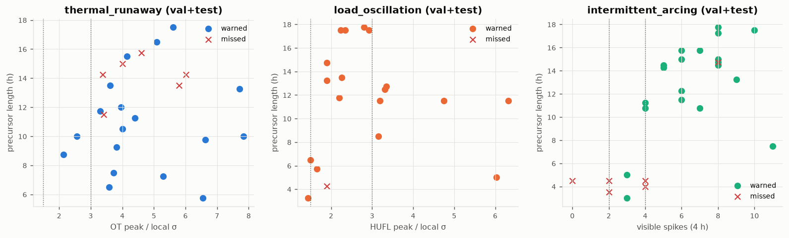

# Failure detectability analysis

> **HISTORICAL (Phase 1 / Phase 2).** Kept as a research record. Operating-point metrics here use the Phase-1 threshold (0.659) and the original validation events. Final results: [`final_project_quality_report.md`](final_project_quality_report.md) and `reports/final/*.json`.

Each simulated failure is graded by how much precursor signal the *available sensors* carry, measured from simulator ground truth (analysis only, never a model input). Local σ is the 7-day std of the deviation from the 24 h mean of the **real** signal just before the precursor starts, so it captures the season and asset the failure happens in.

| Class | Definition (fixed before computing recall) |
|---|---|
| A — strongly detectable | thermal/oscillation peak injected amplitude in the last 2 h ≥ 3.0 local σ; arcing ≥ 4 visible spikes in last 4 h |
| B — moderately detectable | 1.5–3.0 σ; arcing 2–3 spikes |
| C — weakly detectable | < 1.5 σ; arcing < 2 spikes |
| D — fundamentally unpredictable | `sudden` failures: no precursor in any sensor |

## Class counts per split

| split   |   A |   B |   C |   D |
|:--------|----:|----:|----:|----:|
| test    |  22 |   9 |   2 |   7 |
| train   | 108 |  42 |   6 |  25 |
| val     |  28 |   7 |   1 |   5 |

## val split (selected Phase-1 model, threshold 0.659)

* total_failures: **41**
* detectable_failures (A+B+C): **36**
* undetectable (D): **5**
* recall_all: **0.780**
* recall_detectable (A+B+C): **0.889**
* recall_A+B: **0.886**
* recall_by_class: **{'A': '25/28', 'B': '6/7', 'C': '1/1', 'D': '0/5'}**

| type                | class   |   detected |   failures |   recall |
|:--------------------|:--------|-----------:|-----------:|---------:|
| intermittent_arcing | A       |         12 |         13 |     0.92 |
| intermittent_arcing | B       |          1 |          1 |     1    |
| load_oscillation    | A       |          3 |          3 |     1    |
| load_oscillation    | B       |          5 |          6 |     0.83 |
| load_oscillation    | C       |          1 |          1 |     1    |
| sudden              | D       |          0 |          5 |     0    |
| thermal_runaway     | A       |         10 |         12 |     0.83 |

## test split (selected Phase-1 model, threshold 0.659)

* total_failures: **40**
* detectable_failures (A+B+C): **33**
* undetectable (D): **7**
* recall_all: **0.600**
* recall_detectable (A+B+C): **0.727**
* recall_A+B: **0.742**
* recall_by_class: **{'A': '16/22', 'B': '7/9', 'C': '1/2', 'D': '0/7'}**

| type                | class   |   detected |   failures |   recall |
|:--------------------|:--------|-----------:|-----------:|---------:|
| intermittent_arcing | A       |          6 |          8 |     0.75 |
| intermittent_arcing | B       |          1 |          3 |     0.33 |
| intermittent_arcing | C       |          0 |          1 |     0    |
| load_oscillation    | A       |          4 |          4 |     1    |
| load_oscillation    | B       |          4 |          4 |     1    |
| load_oscillation    | C       |          1 |          1 |     1    |
| sudden              | D       |          0 |          7 |     0    |
| thermal_runaway     | A       |          6 |         10 |     0.6  |
| thermal_runaway     | B       |          2 |          2 |     1    |

## Signal strength vs detection (test)

## Interpretation

* 7 of 40 test failures (sudden) carry no precursor; any recall over all failures is capped at 82%.
* Test recall by class: A 0.73 (n=22), B 0.78 (n=9), C 0.50 (n=2)
* Recall is **not** monotonic in signal strength: weaker classes are not detected less often, so the misses are **not** explained by precursor SNR alone.
* Missed detectable failures: 9 — by type/class: intermittent_arcing/A: 2, intermittent_arcing/B: 2, intermittent_arcing/C: 1, thermal_runaway/A: 4
* 6 missed failures are class **A** (strong signal) — e.g. intermittent_arcing ETTm1 2018-03-12 (4.0), thermal_runaway ETTm1 2018-04-15 (3.4), thermal_runaway ETTm1 2018-04-19 (5.8), thermal_runaway ETTm1 2018-05-19 (4.6), thermal_runaway ETTm1 2018-06-09 (6.0). These are model/threshold errors, not sensor limits.

Per-failure table: `reports/phase2/detectability_per_failure.csv`.