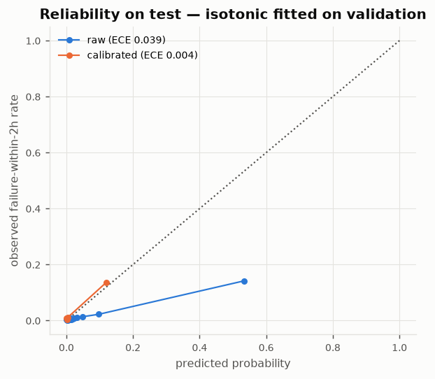

# Calibration & model confidence (Phase 2)

Model: `phase1_selected`. Calibrators are fitted on the **validation** period only; the method is chosen by 2-fold time-split cross-fitting *within* validation (Brier score). Test and re-simulated sets are used only to report.

## Method selection (cross-fitted inside validation)

| method      |   cv_ece |   cv_brier |
|:------------|---------:|-----------:|
| isotonic    |   0.0054 |     0.0108 |
| platt       |   0.0062 |     0.0109 |
| temperature |   0.0458 |     0.0267 |
| identity    |   0.0539 |     0.0268 |

**Chosen: `isotonic`** (T = 1.000, b = 0.000).

## Out-of-sample calibration (mean over sets)

|                                   |   brier |    ece |
|:----------------------------------|--------:|-------:|
| ('test (original', 'identity')    |  0.0248 | 0.039  |
| ('test (original', 'isotonic')    |  0.0131 | 0.0045 |
| ('test (original', 'platt')       |  0.0126 | 0.0044 |
| ('test (original', 'temperature') |  0.025  | 0.033  |
| ('test (re', 'identity')          |  0.0223 | 0.0371 |
| ('test (re', 'isotonic')          |  0.0122 | 0.0043 |
| ('test (re', 'platt')             |  0.0119 | 0.0045 |
| ('test (re', 'temperature')       |  0.0223 | 0.0305 |
| ('val (re', 'identity')           |  0.0243 | 0.0465 |
| ('val (re', 'isotonic')           |  0.012  | 0.0031 |
| ('val (re', 'platt')              |  0.0117 | 0.0037 |
| ('val (re', 'temperature')        |  0.0241 | 0.0383 |

Lower is better. `identity` = raw model score. Weighted-BCE training inflates raw scores (pos_weight ≈ 7.9), which is what calibration corrects.

## Model confidence (uncertainty) — does it flag mistakes?

| method                    |   auroc_conf_vs_error_all |   auroc_conf_vs_false_alarm |   alarm_precision_high_conf |   alarm_precision_low_conf |
|:--------------------------|--------------------------:|----------------------------:|----------------------------:|---------------------------:|
| seed ensemble (3 members) |                     0.873 |                       0.733 |                       0.494 |                      0.143 |
| MC dropout (20 passes)    |                     0.882 |                       0.726 |                       0.451 |                      0.155 |

`auroc_conf_vs_false_alarm` > 0.5 means lower confidence is associated with alarms that turn out false. Confidence is defined as **1 − 2·σ** of the three seed-ensemble members' probabilities (*model confidence*, not physical certainty).

Confidence distribution on test: {'median': 0.9885860681533813, 'p05': 0.7889021039009094, 'median_in_alarms': 0.4871995747089386}
